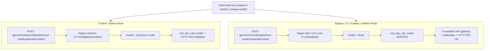

# 113, LiteLLM serves a virtual key a model outside its allowlist via Google GenAI GA and Alpha pass-through routes

- **Upstream**: [BerriAI/litellm](https://github.com/BerriAI/litellm). Sibling
  finding 111 (Kairo PR #77) and upstream issue
  [#48760](https://github.com/BerriAI/litellm/issues/48760) (with pending PR
  [#48762](https://github.com/BerriAI/litellm/pull/48762)) cover the conflicting
  dual-source bypass on `/v1beta/models/...:generateContent` when a client supplies
  an allowed model in the JSON body. Separate passthrough reports include
  [#41467](https://github.com/BerriAI/litellm/issues/41467) (Watsonx body
  `model_id`) and [#41810](https://github.com/BerriAI/litellm/issues/41810) (Chat
  completions `?model=`). None of these cover the regex omission on the built-in
  Google pass-through route (`/gemini/{endpoint:path}`) for GA (`/v1/`), Alpha
  (`/v1alpha/`), or unanchored `/models/` endpoints.
  Classification: `novel`.
- **Tool under test**: LiteLLM proxy release `v1.108.0` and source `main`
  commit [`cfe0100e`](https://github.com/BerriAI/litellm/commit/cfe0100e1fca613e7b1af27dd1fe4807ca4d1d1a).
- **Provider**: deterministic local Google AI Studio-compatible upstream
  ([`transcripts/113/rig/fake_upstream.py`](../../transcripts/113/rig/fake_upstream.py)).
  The claim is about which model the gateway dispatches under a virtual-key
  allowlist, so the evidence is the forwarded HTTP request and the client
  response. No provider credentials are used.
- **Reproduced**: 2026-10-31, macOS arm64, proxy with a master key and a Postgres
  backend. One virtual key scoped `models: ["cheap-model"]`. Two registered
  deployments, `cheap-model` and `premium-model`.
- **Label**: `bug`

## Claim

A LiteLLM virtual key scoped `models: ["cheap-model"]` is denied `premium-model`
on `POST /gemini/v1beta/models/premium-model:generateContent` (HTTP 403
`key_model_access_denied`). But on `POST /gemini/v1/models/premium-model:generateContent`,
`:streamGenerateContent`, `POST /gemini/v1alpha/models/premium-model:generateContent`,
and `POST /gemini/models/premium-model:generateContent`, standard Google GenAI SDK
requests (with no body `model`) return HTTP 200 and are served by `premium-model`.
The gateway attaches its server credentials and dispatches the call to the
unauthorized model.

Root cause: in `litellm/proxy/auth/auth_utils.py`, `get_model_from_request` uses
`re.search(r"/(?:v1beta|beta)/models/([^:]+):", route)` to extract models from
URL-routed Google endpoints. This pattern only matches `v1beta` and `beta`,
omitting Google General Availability (`/v1/`), Google Alpha (`/v1alpha/`), and
the `/gemini/models/` path prefix (due to a `^/models/` regex anchor). Because
Google GenAI payloads place the model only in the URL path, `get_model_from_request`
returns `None`. Both key-level and team-level access checks no-op when `model` is
`None`, so the request bypasses authorization and is relayed upstream.



## What breaks

An operator configures LiteLLM with a Google AI Studio provider key and issues
virtual keys scoped to cheap models (`models: ["cheap-model"]` or
`["gemini-1.5-flash"]`) to limit tenant spend.

When a tenant sends normal Google GenAI API traffic:
- If their client targets the beta endpoint (`/gemini/v1beta/models/...`), LiteLLM
  enforces the allowlist and returns HTTP 403.
- If their client targets Google's stable GA endpoint (`/gemini/v1/models/...`),
  the experimental endpoint (`/gemini/v1alpha/models/...`), or `/gemini/models/...`,
  LiteLLM fails to parse the model name and skips authorization. The proxy
  attaches the server's `GEMINI_API_KEY` and forwards the call to `premium-model`.

Unlike finding 111, which required injecting a conflicting allowed model into the
JSON body to fool the body-first reader, this bypass triggers on standard,
unmodified Google GenAI SDK requests.

## Results

Every cell is 5 of 5 runs on LiteLLM 1.108.0 and source `main` (`cfe0100e`).

| Cell | Route | Body | Expected | Observed | Forwarded Model |
| :--- | :--- | :--- | :--- | :--- | :--- |
| `gemini-v1-path-denied` | `POST /gemini/v1/models/premium-model:generateContent` | standard (no model) | 403 | 200 | `premium-model` (5/5) |
| `gemini-v1-stream-path-denied` | `POST /gemini/v1/models/premium-model:streamGenerateContent` | standard (no model) | 403 | 200 | `premium-model` (5/5) |
| `gemini-v1alpha-path-denied` | `POST /gemini/v1alpha/models/premium-model:generateContent` | standard (no model) | 403 | 200 | `premium-model` (5/5) |
| `gemini-models-path-denied` | `POST /gemini/models/premium-model:generateContent` | standard (no model) | 403 | 200 | `premium-model` (5/5) |
| `gemini-v1beta-control` | `POST /gemini/v1beta/models/premium-model:generateContent` | standard (no model) | 403 | 403 | None (denied before relay) |
| `gemini-v1-cheap-control` | `POST /gemini/v1/models/cheap-model:generateContent` | standard (no model) | 200 | 200 | `cheap-model` (5/5) |

## Wire evidence

From `transcripts/113/wire/`:

1. Failing case (`gemini-v1-path-denied/run-01/`):
   - `client-request.http`:
     ```http
     POST /gemini/v1/models/premium-model:generateContent?key=[REDACTED] HTTP/1.1
     content-type: application/json

     {"contents": [{"role": "user", "parts": [{"text": "hi"}]}]}
     ```
   - `client-response.http`:
     ```http
     HTTP/1.1 200
     content-type: application/json

     {"candidates": [{"content": {"parts": [{"text": "served-by-upstream-model=premium-model"}], "role": "model"}, "finishReason": "STOP", "index": 0}], ...}
     ```
   - `upstream/fwd-request.http`:
     ```http
     POST /v1/models/premium-model:generateContent?key=fake-gemini-master-key HTTP/1.1
     Host: 127.0.0.1:4927
     Content-Type: application/json

     {"contents":[{"role":"user","parts":[{"text":"hi"}]}]}
     ```

2. Control case (`gemini-v1beta-control/run-01/`):
   - `client-request.http`:
     ```http
     POST /gemini/v1beta/models/premium-model:generateContent?key=[REDACTED] HTTP/1.1
     content-type: application/json

     {"contents": [{"role": "user", "parts": [{"text": "hi"}]}]}
     ```
   - `client-response.http`:
     ```http
     HTTP/1.1 403

     {"error":{"message":"The requested model 'premium-model' is not available for this API key, or the model name is invalid. Check the models available to you and try again.","type":"key_model_access_denied","param":"model","code":"403"}}
     ```
   - `upstream/`: absent (request blocked at auth, zero upstream traffic).

## Root cause

In `litellm/proxy/auth/auth_utils.py`:
```python
    # If still not found, extract model from Google generateContent-style routes.
    # These routes put the model in the path and allow "/" inside the model id.
    # Examples:
    # - /v1beta/models/gemini-2.0-flash:generateContent
    # - /v1beta/models/bedrock/claude-sonnet-3.7:generateContent
    # - /models/custom/ns/model:streamGenerateContent
    if model is None and not route.lower().startswith("/vertex"):
        google_match = re.search(r"/(?:v1beta|beta)/models/([^:]+):", route)
        if google_match:
            model = google_match.group(1)

    if model is None and not route.lower().startswith("/vertex"):
        google_match = re.search(r"^/models/([^:]+):", route)
        if google_match:
            model = google_match.group(1)
```

The first regex requires literal `v1beta` or `beta`. Google's production GA
endpoints use `/v1/`, and experimental endpoints use `/v1alpha/`.

The second regex uses `^/models/`, which matches only when the URL path begins
with `/models/`. Under the pass-through handler, the route begins with
`/gemini/models/`, which fails the anchor.

In `litellm/proxy/auth/user_api_key_auth.py` and `auth_checks.py`:
```python
model = _get_model_from_request_context(...)
if model is not None:
    await can_key_call_model(...)
```
When `model` is `None`, `can_key_call_model` is skipped entirely.

## Upstream status

Checked 2026-10-31.
- Searched upstream issues and pull requests for `gemini allowlist`,
  `get_model_from_request`, `/(?:v1beta|beta)/models/`, and `gemini pass-through`.
- Sibling findings:
  - #41467 (Watsonx pass-through `model_id` body omission, open)
  - #41810 (Chat completions `?model=` query string bypass, open)
  - #48760 (Google `generateContent` body/URL dual-field bypass, open)
- Classification: `novel`. No dedicated issue or pull request exists for the
  omission of `/v1/`, `/v1alpha/`, or unanchored `/models/` in the Google route
  pattern resolver.

## Bug or not

- **Is the expected behavior really the spec?**
  Yes. The docstring of `get_model_from_request` (`auth_utils.py`) specifies:
  `"Built-in provider passthrough routes (/vertex_ai, /gemini, ...) are separate handlers and keep model enforcement."`
  The code comments and regex directly confirm the intention to parse models from
  Google generateContent routes.
- **Have maintainers already ruled on it?**
  Yes. Maintainers have consistently affirmed that virtual-key model allowlists
  are mandatory boundaries (e.g. #41810, #41852, #48762).
- **Is the trigger supported usage?**
  Yes. Calling `/gemini/{endpoint:path}` with a LiteLLM virtual key is documented
  supported usage. Standard SDK requests send no body model.
- **Is a real boundary crossed?**
  Yes. An authenticated caller holding a key restricted to `models: ["cheap-model"]`
  successfully executes requests against `premium-model` using the operator's
  credentials.
- **What fix would a maintainer ship?**
  Update the regex in `auth_utils.py` to match `/(?:v1|v1beta|v1alpha|beta)/models/([^:]+):`
  and remove the caret anchor on the `/models/` fallback.

## Test

Harness conformance test in `crates/harness/tests/conformance.rs` asserts that every
recorded cell satisfies `served_model_within_key_allowlist`. The 403 control is
conformant; the bypass cells violate the invariant by serving `premium-model`
under HTTP 200.
